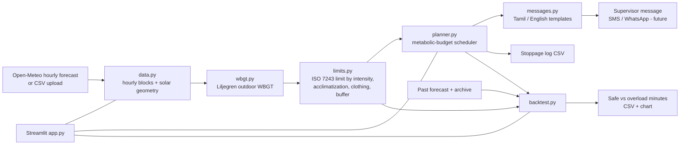
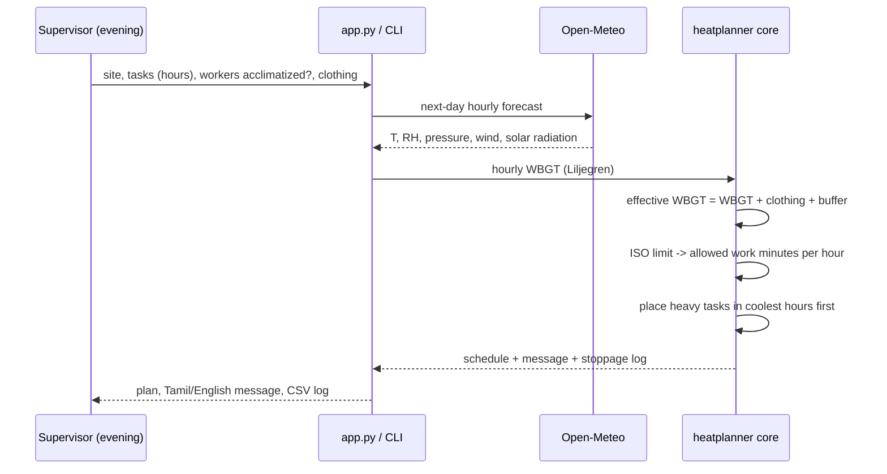

# Technical Design: Heat-Safe Shift Planner

## 1. Goal
Give a construction-site supervisor in Tamil Nadu a next-day, hour-by-hour work-rest plan that keeps work within
ISO 7243 heat-stress limits, instead of a fixed clock rule such as "no work 12-3 pm".

## 2. Architecture

## 3. Data flow (one planning run)

## 4. Method
**Weather to WBGT.** Hourly block [h, h+1) uses the mean of the values at h and h+1 for temperature, humidity,
wind and pressure, and the radiation stamped h+1 (Open-Meteo radiation is the mean of the preceding hour). The cosine of the solar
zenith angle is computed for the middle of the block (NOAA low-precision formula). WBGT is computed with the
Liljegren model (`thermofeel.calculate_wbgt_liljegren`). The simplified formula `0.567Ta + 0.393e + 3.94` is
deliberately **not** used: it greatly overestimates heat stress in hot-humid regions.

**ISO limit to work minutes.** ISO 7243 gives a WBGT limit per metabolic class. The highest class whose limit is at
or above the effective WBGT gives the admissible average metabolic rate `M_adm`. For work at `M_work`, with rest at
65 W/m2, the work fraction per hour is `f = (M_adm - 65) / (M_work - 65)`, clamped to 0..1, and minutes are rounded
down to multiples of 5.

**Planner.** Each hour has a budget `60 * (M_adm - 65)`; a minute of work at intensity `M` costs `M - 65`. Tasks are
sorted heaviest first and placed into the coolest hours (largest budget) in 5-minute steps; lighter tasks use the
leftover budget. A schedule therefore never exceeds the ISO limit for the forecast it was built on.

**Forecast uncertainty.** `buffer` (deg C) is added to forecast WBGT. The backtest estimates it as the 90th percentile
of (actual - forecast) WBGT error on a calibration half of the days, then evaluates on the other half.

**Stoppage log.** Every hour records the model WBGT, clothing adjustment, buffer, effective WBGT, limit applied,
decision and minutes per task, so a decision can be audited later.

## 5. Backtest design
Policies (all try to schedule 8 work-hours of the same heavy task): status quo 9-6 with lunch; blanket 12-3 break;
planner without buffer; planner with buffer; planner with perfect knowledge (upper bound).
Metrics: scheduled, **safe** (within the allowed minutes for the actual weather) and **overload** minutes.
Caution: with a perfect forecast the planner cannot exceed the limit by construction, so the meaningful comparisons are
(a) planner vs fixed shifts under forecast error and (b) how much safe work a fixed 12-3 rule loses or allows.

## 6. Tests
28 pytest tests cover the ISO table and work fractions, monotonicity, the planner budget, buffers, messages (no
unfilled placeholders), solar geometry, WBGT sanity, data loading and backtest invariants. Run `python -m pytest -q`.

## 7. Scalability and roadmap
Other districts: change latitude/longitude. Other occupations: add task presets. Planned: SMS/WhatsApp delivery,
IVR voice notes, on-site sensor bias correction, downscaling with local land cover, a supervisor-adherence feedback loop,
and wage-protection integration with the welfare board (policy proposal, not built).

## 8. Privacy and safety
The prototype stores no personal data. A real deployment would store supervisor phone numbers and must follow
consent and data-protection rules. The tool supports decisions; it does not replace a safety officer.
